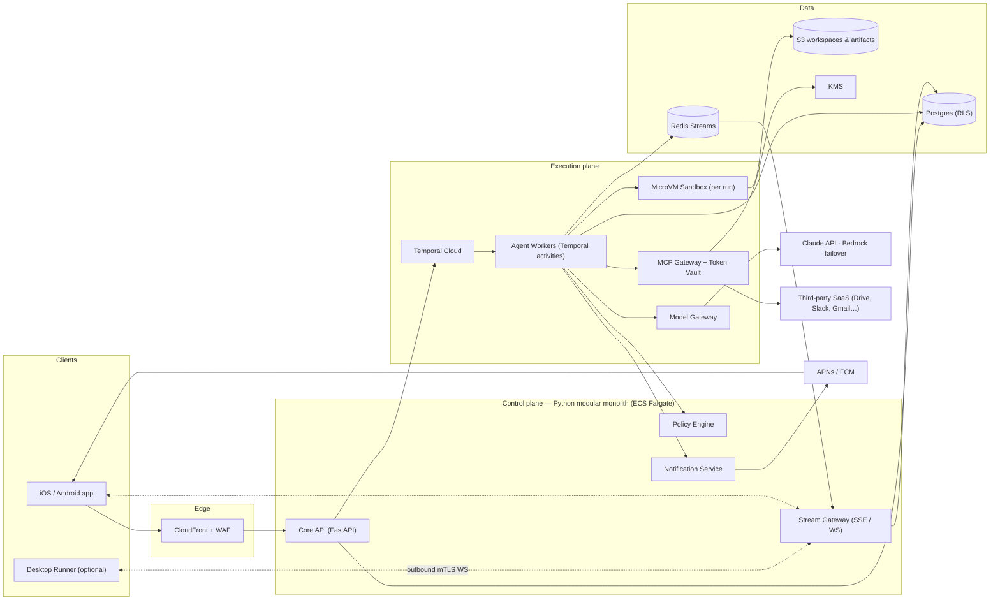
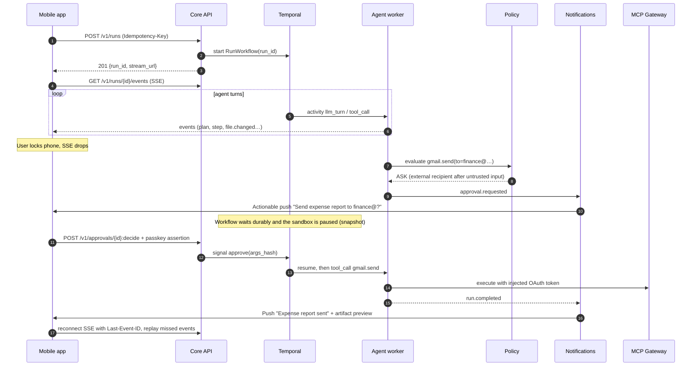
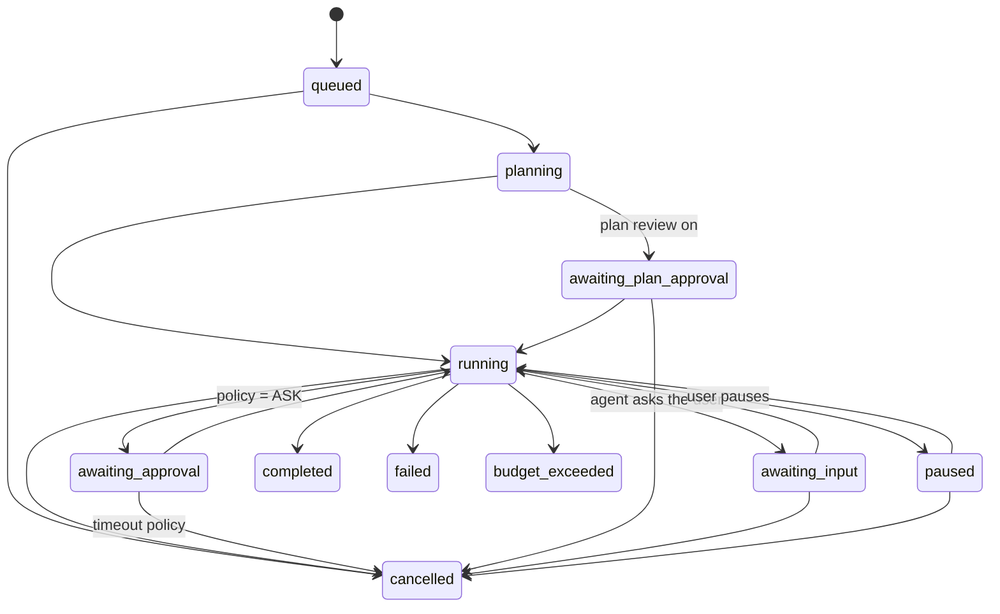
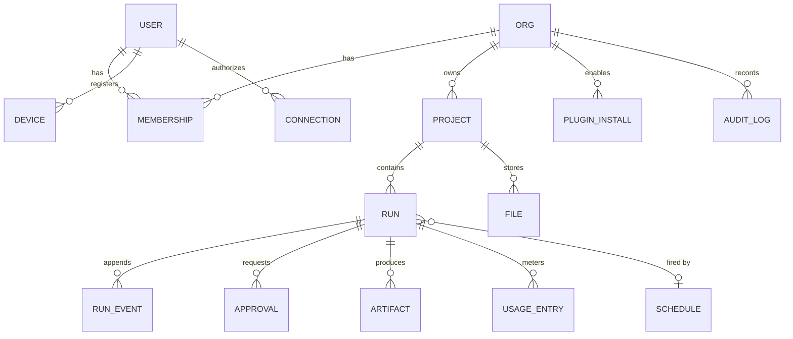

# Cowork Mobile — Backend Architecture Spec

> **Scope:** SaaS backend for a mobile-app-centric version of Claude Cowork.
>
> **Stack:** Python 3.12 · FastAPI · Temporal · Postgres · Redis · S3 · microVM sandboxes · Claude API
>
> **Companion:** [`IMPLEMENTATION_PROMPT.md`](./IMPLEMENTATION_PROMPT.md) — the tested build prompt (and revision log) that turns this spec into an MVP.

---

## 0. TL;DR

1. **The phone is a remote control, not a computer.** Desktop Cowork runs the agent in a local VM. On mobile, execution moves to **cloud microVM sandboxes**, with an optional **paired desktop** as a second execution target (Dispatch).
2. **Every run is a durable workflow.** Agent loops run on **Temporal**, so a run survives app backgrounding, dropped connections, worker crashes, and approvals that take hours.
3. **The client never misses anything.** All progress is an **append-only event log** with sequence cursors. The app reconnects with `Last-Event-ID` and replays; pushes cover the gaps when the app is closed.
4. **Approvals belong on the lock screen.** Risky tool calls pause the run and send an **actionable push**. High-risk approvals need a **biometric step-up** bound to the exact action.
5. **Startup-sized, scale-ready.** One Python modular monolith plus workers on managed services. Every component that will need to scale sits behind an interface we can swap later.

---

## 1. Context, Assumptions, Non-Goals

| | |
|---|---|
| **Product** | Users hand Claude a goal ("turn these receipts into an expense report and email it to finance"); Claude plans, uses files, code, browser and connected apps, and returns finished deliverables. |
| **Assumptions** | We are a startup consuming Claude via the Anthropic API (Bedrock/Vertex as failover). Team of 3–5 backend engineers. Native iOS + Android clients. Target: 50k MAU in year 1, architecture credible to 1M. |
| **Non-goals (v1)** | Training models; on-prem deployment; real-time multi-user co-editing of a single run; data residency outside US/EU. |

---

## 2. Feature Inventory → Backend Capability

Source: claude.com/product/cowork and the Claude Help Center (Cowork, Connectors, Plugins, Scheduled tasks, Dispatch), reviewed Nov 2026.

| # | Cowork feature | Backend capability (this spec) | Phase |
|---|---|---|---|
| F1 | Goal → multi-step plan → execution | Agent loop as a Temporal workflow; plan proposal step | MVP |
| F2 | Live step tracking, steer/redirect mid-task | Event log + SSE stream; `POST /v1/runs/{id}/messages` signals the workflow | MVP |
| F3 | Read/write files; deliverables (xlsx with formulas, pptx, docx) | Project workspace in S3, mounted into the sandbox; artifact service with mobile previews | MVP |
| F4 | Runs scripts to process data, iterates on errors | Code execution inside per-run microVM sandbox | MVP |
| F5 | Sub-agents in parallel | Child workflows with their own budgets; results merged by parent | MVP |
| F6 | Isolated built-in browser (sign in per session) | Headless Chromium inside the sandbox; live frames streamed to the phone; encrypted per-session cookie jar | v1.1 |
| F7 | Connectors (Drive, Slack, Gmail, Notion…) inheriting user permissions; per-task scoping | MCP Gateway with OAuth token vault; per-run connector allowlist | MVP |
| F8 | Skills & plugins (skills, connectors, hooks, sub-agents), synced across devices | Versioned, signed plugin bundles; progressive skill loading; hooks run only in the sandbox | v1.1 |
| F9 | Scheduled / recurring tasks that run while you're away | Temporal Schedules → unattended runs with frozen config and an unattended approval policy | MVP |
| F10 | Permission modes (ask vs auto) | Policy engine evaluates every tool call: `allow` / `ask` / `deny` | MVP |
| F11 | Dispatch: start from phone, run on desktop | Desktop Runner holds an outbound WebSocket; orchestrator routes tool calls to it | v1.1 |
| F12 | Projects, instructions, memory | Project-scoped instructions and files; opt-in per-user memory store | MVP |
| F13 | Enterprise: admin controls, SSO, audit/compliance, retention | SSO/SCIM, org policies, append-only audit log, compliance export API, retention jobs | v1.2 |
| F14 | Plan usage limits | Usage ledger (tokens, sandbox-seconds) → quotas & billing | MVP |

---

## 3. What "Mobile-First" Changes

| Desktop assumption | Mobile reality | Design response |
|---|---|---|
| Agent runs on the user's machine | Phone can't host a VM; OS kills background apps | Cloud sandboxes; client is a thin viewer/controller |
| Persistent connection to the UI | Flaky cellular, app suspended in seconds | Event log + cursor replay; push for state changes |
| Modal permission dialogs | User is in a meeting, phone locked | Actionable push + Live Activities / ongoing notifications; runs wait durably |
| Local folders are the context | Context lives in the camera roll, share sheet, voice, cloud drives | Resumable uploads, Share Extension, voice/photo ingestion, connector-first files |
| Big screen for outputs | 6-inch screen | Server-side renditions (PDF/PNG previews), summaries first, full files on demand |
| Unlimited bandwidth & battery | Metered data, battery budget | Delta coalescing (~100 ms), thumbnail browser frames at ≤1 fps on cellular, `collapse-key` pushes |

---

## 4. Architecture



| Component | Responsibility | Why this choice |
|---|---|---|
| **Core API** (FastAPI, Pydantic v2) | Auth, CRUD, run creation, uploads, approvals. OpenAPI is the contract; Swift/Kotlin clients are generated from it. | Python's AI ecosystem (Anthropic SDK, MCP SDK, evals); typed contracts |
| **Stream Gateway** | SSE (primary) + WebSocket (desktop runner). Live tail from Redis Streams, replay from Postgres. | SSE survives proxies, auto-reconnects, is cheap on battery |
| **Temporal** | Durable agent loop, child workflows (sub-agents), signals (steer/approve/cancel), timers, Schedules. | Waits of hours cost nothing; crash-safe; built-in retries |
| **Agent Workers** | Run activities: LLM call, tool call, sandbox exec, event append. Stateless, autoscaled on task-queue depth. | Horizontal scaling without sticky sessions |
| **Model Gateway** | Model routing (Opus-class planner, Haiku-class sub-tasks), prompt caching, retries, provider failover, per-run budget enforcement. | LLM spend is ~95% of COGS (see §9) |
| **MCP Gateway** | Hosts connector clients server-side; injects OAuth tokens; classifies tool calls (read/write/destructive); per-run allowlist. | Secrets never enter the sandbox or the model context |
| **Sandbox** | One microVM per run (E2B/Firecracker), workspace mounted, egress via allowlist proxy, snapshot/pause. | Strong isolation for untrusted code; behind a `SandboxProvider` interface so we can self-host later |
| **Notification Service** | Push fan-out, Live Activity updates, collapse keys, quiet hours, digests. | One place for delivery policy |
| **Policy Engine** | Evaluates `(principal, tool, args, taint)` → `allow/ask/deny` from org + user + task settings. | Centralized, testable, auditable |

---

## 5. Key Flows

### 5.1 Run with a lock-screen approval



### 5.2 Run lifecycle



**Durability details**
- Every LLM call and tool call is a Temporal **activity** with timeouts, heartbeats, and retry policies. Non-idempotent tools (send email) use a **tool-call idempotency key** `(run_id, step_id)` that is stored before execution, so a retry never sends twice.
- Long runs use **continue-as-new** every N turns to keep workflow history bounded. Agent context is rebuilt from the event log plus a rolling summary.
- Waiting longer than 60 s for a human **pauses and snapshots the sandbox**, so an approval that takes 3 hours costs storage, not compute.

### 5.3 Other flows (summary)

- **Scheduled task:** A Temporal Schedule fires and starts a run with a *frozen* config (connector scopes, permission mode, budget). Unattended policy: `ask` actions either wait up to T and then auto-deny, or skip and report. Results arrive as a push plus a digest.
- **Dispatch (desktop target):** The run's `target = desktop:{runner_id}`. The orchestrator stays in the cloud; only local tool calls (`fs.*`, `app.*`) go to the runner over its WebSocket. If the runner is offline, the run waits and the user gets a push: "Your Mac is asleep. Wait, or move this run to the cloud?"
- **Capture → task:** Share Extension, camera, or voice note → resumable upload (S3 multipart, presigned) → transcription/OCR activity → run created with attachments.

---

## 6. API & Event Contract

REST, JSON, `/v1`. Every mutating call accepts an `Idempotency-Key`, which lets the mobile **offline outbox** retry safely. Cursor pagination everywhere.

| Method | Path | Notes |
|---|---|---|
| `POST` | `/v1/runs` | `{project_id, prompt, attachments[], connectors[], target, permission_mode, budget_usd}` |
| `GET` | `/v1/runs/{id}` | **Snapshot**: state, plan, last N steps, pending approvals. Cheap cold-start render. |
| `GET` | `/v1/runs/{id}/events?after={seq}` | SSE; honors `Last-Event-ID`; `?profile=cellular` coalesces deltas, thumbnails frames |
| `POST` | `/v1/runs/{id}/messages` | Steer mid-run or answer `awaiting_input` prompts (Temporal signal) |
| `POST` | `/v1/runs/{id}/plan:decide` | Approve, adjust `budget_usd`, or reject proposed plan (`awaiting_plan_approval`) |
| `POST` | `/v1/runs/{id}:pause` · `:resume` · `:cancel` | |
| `POST` | `/v1/approvals/{id}:decide` | `{decision, args_hash, step_up_assertion?}`. Single-use, bound to the exact args. |
| `POST` | `/v1/uploads` | Presigned multipart; resumable |
| `GET` | `/v1/artifacts/{id}` · `/renditions/{kind}` | Original + mobile previews; signed, expiring share links |
| `CRUD` | `/v1/projects` · `/schedules` · `/skills` · `/plugins` · `/memory` | Project config, recurring schedules, plugins, and opt-in user memory |
| `GET/POST` | `/v1/connectors` · `/connectors/{p}/oauth/start` · `/callback` | PKCE; tokens go straight to the vault |
| `POST` | `/v1/devices` | Push token, platform, Live Activity token, app attestation |
| `WS` | `/v1/runners/connect` | Desktop Runner, mTLS + device key |
| `GET` | `/v1/admin/audit` · `/admin/policies` · `/admin/usage` | Enterprise; compliance export |

**Event envelope** (also the storage format):

```json
{ "run_id": "run_01J…", "seq": 42, "type": "tool.called", "ts": "2026-11-22T22:58:01Z",
  "schema": 1, "step_id": "run_01J…:t4:c0", "payload": { "tool": "gmail.send", "summary": "Email to finance@…" } }
```

Event types: `run.state_changed`, `plan.proposed`, `message.delta`, `step.started/finished`, `tool.called/result`, `file.changed`, `browser.frame`, `subagent.spawned/finished`, `approval.requested/resolved`, `artifact.created`, `usage.updated`. `seq` is gap-free per run (written in the same transaction as the step), so the client detects gaps and backfills.

---

## 7. Data Model (Postgres)



- **Tenancy:** Every tenant table carries `org_id`, enforces `FORCE ROW LEVEL SECURITY` via transaction-local `SET LOCAL app.org_id` (`set_config(..., true)` with fail-closed `NULLIF`), and uses composite foreign keys `(org_id, project_id)` / `(org_id, run_id)` so cross-tenant FKs cannot bypass RLS. Each org's S3 prefix is encrypted with a per-org KMS data key.
- **`run_events`:** Append-only, `PRIMARY KEY (run_id, seq)`, range-partitioned by time-ordered ULID `run_id` (so the PK satisfies Postgres's rule that unique constraints include the partition key). Cold partitions archive to S3/Parquet for compliance export.
- **`connections`:** Stores only a vault reference. Refresh and access tokens are envelope-encrypted with KMS and decrypted only inside the MCP Gateway.
- **`audit_log`:** Append-only, hash-chained (each row stores `prev_hash`), so tampering is detectable.

---

## 8. Security & Trust Model

| Threat | Control |
|---|---|
| Untrusted code from the agent | Per-run microVM, no host mounts, CPU/mem/time limits, egress via allowlist proxy, no cloud credentials inside |
| Credential theft / exfiltration | Tokens live only in the MCP Gateway; sandbox and model never see them; per-run connector scopes |
| **Prompt injection** (poisoned doc, web page, email) | Content from connectors/browser is tagged **untrusted**. **Taint-aware policy:** once a run has read untrusted content, any write to an *external* destination escalates to `ask`. Tool results are wrapped in delimiters and never treated as instructions. |
| Approval replay / TOCTOU | Approval bound to `(run_id, step_id, sha256(args))`, single-use, 15-min expiry; high-risk needs a passkey/biometric assertion verified server-side |
| Device / session compromise | OIDC (Apple, Google), passkeys, short-lived access JWT (10 min) + rotating refresh tokens bound to a device key; App Attest / Play Integrity on sensitive endpoints; remote device revoke |
| Cross-tenant leakage | RLS, per-org KMS keys, single-tenant sandboxes, tenant-tagged traces |
| Malicious plugin | Signed bundles, org allowlist, hooks run only in the sandbox, declared permissions shown before install |

Compliance path: SOC 2 Type I at month 6 → Type II at month 12; GDPR DSAR/delete jobs; configurable retention per org.

---

## 9. Reliability, Observability, Cost

**SLOs (MVP)**

| SLI | Target |
|---|---|
| API availability (non-LLM endpoints) | 99.9% |
| Time from `POST /v1/runs` to first event | p95 < 2 s |
| Sandbox ready (warm pool / snapshot restore) | p95 < 1.5 s |
| Event loss on reconnect | 0 (replay guaranteed) |
| Push delivery for `approval.requested` | p95 < 5 s |
| Runs lost to infra failure | 0 (Temporal + Postgres) |

**Observability:** OpenTelemetry traces span app → API → workflow → activity → LLM/MCP/sandbox, keyed by `run_id`. Logs are structured JSON with PII redaction. Sentry covers backend and both apps. LLM tracing (Langfuse) ties each turn to a **prompt version**. Every run has a **cost ledger**. Alerts fire on SLO burn rate, not raw errors.

**Unit economics (illustrative; assumptions labeled).** A typical 25-turn run at ~40k context tokens/turn, 80% prompt-cache hit (32k cached read), 20% uncached input (split evenly between 4k/turn new 5-min cache-write tokens at 1.25× = \$3.75/MTok and 4k/turn uncached tokens at 1.0× = \$3.00/MTok), and 1.5k output tokens/turn; Sonnet-class list pricing (\$3.00 in / \$3.75 cache-write / \$0.30 cache-read / \$15.00 out per MTok):

| Item | Cost |
|---|---|
| Cache writes (25 × 4k = 100k @ \$3.75/MTok) | \$0.38 |
| Uncached input (25 × 4k = 100k @ \$3.00/MTok) | \$0.30 |
| Cached input (25 × 32k = 800k @ \$0.30/MTok) | \$0.24 |
| Output (25 × 1.5k = 37.5k @ \$15.00/MTok) | \$0.56 |
| Sandbox, 10 min | ~\$0.02 |
| **Total** | **≈ \$1.50 / run** |

**Takeaway:** compute is a rounding error and **tokens are the business**. Our levers are model routing (Haiku-class for sub-agents and summaries), prompt caching, context compaction, and a **cost preview plus hard budget per run**.

**Scale path**

| Stage | Users | Changes |
|---|---|---|
| **MVP** | ≤ 50k MAU | Modular monolith + workers; managed Postgres, Redis, Temporal Cloud, E2B |
| **Growth** | ≤ 500k | Split Stream Gateway into its own service; read replicas; event-log partitions archived to S3; worker pools per task type |
| **Scale** | 1M+ | Self-hosted Firecracker fleet (cost); multi-region active-passive; shard Postgres by `org_id` (Citus); consider rewriting the Stream Gateway in Go if fan-out demands it |

---

## 10. Engineering Practices

**Repo (uv workspace monorepo)**

```
cowork-backend/
├── apps/
│   ├── api/            # FastAPI app: routers, auth, OpenAPI
│   ├── stream/         # SSE/WS gateway (same image in MVP)
│   └── worker/         # Temporal workflows + activities
├── packages/
│   ├── domain/         # Pydantic models, event schemas (single source of truth)
│   ├── agent/          # loop, tool registry, context builder, prompts (versioned)
│   ├── sandbox/        # SandboxProvider protocol + E2B adapter + fake
│   ├── mcp_gateway/    # connector clients, token vault
│   ├── policy/         # allow/ask/deny rules + taint tracking
│   └── llm_gateway/    # routing, caching, budgets, failover
├── evals/              # golden tasks, rubrics, injection corpus
├── infra/terraform/
├── migrations/         # Postgres DDL (RLS, ULID partitions, audit chain)
├── tests/
└── pyproject.toml      # uv workspace, ruff, mypy --strict, pytest
```

- **Quality gates:** ruff, mypy `--strict`, pytest (+ pytest-asyncio, Hypothesis for event ordering), Alembic migrations checked in CI, pre-commit.
- **Test pyramid:** unit → contract (Schemathesis against OpenAPI) → **Temporal replay tests** (workflow determinism) → integration (Testcontainers: Postgres, Redis, Temporal dev server, fake sandbox) → **chaos** (kill a worker mid-run; the run must finish exactly once) → load (Locust: 10k concurrent SSE streams).
- **Agent evals as CI:** 50+ golden tasks (deterministic checks plus an LLM-judge rubric) and a prompt-injection corpus. A prompt or model change that regresses the score blocks merge.
- **Delivery:** GitHub Actions → staging → canary → prod (ECS blue/green). Feature flags per capability. Terraform for all infra. Zero-downtime migrations (expand/contract).
- **Docs:** ADRs in-repo, OpenAPI published, runbooks linked from alerts.

**MVP delivery plan (12 weeks, 4 engineers)**

| Weeks | Milestone |
|---|---|
| 1–2 | Foundations: auth, orgs, projects, CI/CD, infra, observability |
| 3–6 | Runs: workflow, event log, SSE, sandbox, files/uploads, artifacts + renditions |
| 7–9 | Connectors (MCP Gateway), policy engine, approvals, push + Live Activities |
| 10–12 | Schedules, sub-agents, usage/billing, evals in CI, closed beta |
| Post-MVP | Browser (F6), plugins/skills (F8), Desktop Runner (F11), enterprise (F13) |

---

## 11. Standout Additions (beyond Cowork parity)

1. **Lock-screen agent control.** Live Activity (iOS) / ongoing notification (Android) shows the current step, progress, and cost. Approve or deny from the notification; destructive actions need Face ID / a passkey bound to the action hash.
2. **Plan & cost preview.** Before a run starts, the user sees a one-screen plan card: steps, connectors touched, estimated cost and time. One tap to approve, edit, or set a budget cap. This builds trust and protects margins.
3. **Capture-to-task.** Share a PDF, snap a whiteboard, or send a 20-second voice note; the backend transcribes, OCRs, and turns it into a scoped task. This is the mobile-native way to give context.
4. **Run receipts.** Each finished run produces a signed, human-readable receipt (what was read, written, sent, and what it cost), generated from the audit log. Shareable with a manager or compliance.
5. **Execution target routing.** The same run can target the cloud or a paired desktop, and can move from desktop to cloud mid-run when the laptop sleeps (workspace files permitting).

---

## 12. Architecture Decision Records (summary)

| # | Decision | Alternatives | Why |
|---|---|---|---|
| ADR-1 | **Python** for control + execution plane | Go, TypeScript | Best AI/MCP/eval ecosystem; one language for agent and API. Trade-off: raw throughput. Mitigation: I/O-bound async design; Stream Gateway is isolated so it can be rewritten. |
| ADR-2 | **Temporal** for agent runs | Celery/RQ, Step Functions, homegrown state machine | Hours-long human waits, signals, child workflows, Schedules, replay testing. Celery can't wait durably for days. |
| ADR-3 | **SSE + event log** (not WebSocket-only) | WebSocket, polling, GraphQL subscriptions | Resumable by design (`Last-Event-ID`), HTTP/2-friendly, cheaper on battery. WS only for desktop runners. |
| ADR-4 | **Managed microVMs (E2B)** behind an interface | Docker on our hosts, gVisor, self-hosted Firecracker | VM-grade isolation on day 1 with zero ops; switch to self-hosted when volume justifies it. |
| ADR-5 | **Server-side MCP Gateway** | Connectors inside the sandbox | Keeps tokens out of untrusted environments; central policy and audit. |
| ADR-6 | **Modular monolith** | Microservices | 4 engineers; clear package boundaries let us split later without a rewrite. |
| ADR-7 | **Postgres RLS** multi-tenancy | DB-per-tenant | Simple ops at startup scale; enterprise tenants can get dedicated DBs later. |

---

## 13. Risks & Open Questions

| Risk | Mitigation |
|---|---|
| LLM cost per run exceeds plan revenue | Budgets, routing, caching, cost preview; usage-based tiers |
| Prompt injection via connectors | Taint-aware policy, `ask` on external writes, injection evals in CI |
| Sandbox provider lock-in or outage | `SandboxProvider` interface; second provider (Modal) adapter; graceful "queued" state |
| Provider rate limits during spikes | Per-org token buckets in the Model Gateway; Bedrock failover; queue with ETA in UI |
| iOS background limits on long uploads | Background URLSession + resumable multipart |

**Open questions for the interview:**
1. *Should plan review be default-on for new users?* (Recommended: default-on for the first N runs to build trust and budget visibility, then user-configurable.)
2. *What is the right unattended-approval policy for schedules?* (Recommended: wait up to a short window `T` for high-confidence actions if push is enabled, otherwise skip the gated step, log it, and surface a one-tap retry in the completion digest.)
3. *When does desktop→cloud handoff violate a user's expectation that "my files stay on my machine"?* (Recommended: require explicit per-run or per-project opt-in before syncing local desktop workspaces to S3 for cloud continuation.)
